# Awesome-Dynamic-Product-Plan-Catalog 🚀

  

  
  
  
  
  
  
  

---

## 🌟 Top Dynamic Product & Plan Catalog Ecosystem

**A Curated Directory of Enterprise SaaS Platforms & High-Performance Open-Source GitHub Projects for Product Information Management (PIM), Product Experience Management (PXM), Dynamic Plan Catalogs, Digital Asset Management (DAM), and Multi-Channel Commerce Syndication.**

Welcome to the **Awesome Dynamic Product & Plan Catalog** directory! Whether you are an enterprise architect evaluating scalable PIM/PXM infrastructure or an engineering team seeking self-hosted, headless catalog software without vendor lock-in, this guide provides actionable intelligence, pricing models, company scales, and open-source star benchmarks.

---

## 📑 Table of Contents

- [📊 Sector Overview & Market Dynamics](#-sector-overview--market-dynamics)
- [🏢 SaaS / Hosted Platforms](#-saashosted-platforms)
- [💻 Open-Source GitHub Projects](#-open-source-github-projects)
- [🤝 How to Contribute](#-how-to-contribute)
- [💖 Support & Sponsorship](#-support--sponsorship)
- [📈 Star History](#-star-history)
- [⚠️ Disclaimer](#-disclaimer)

---

## 📊 Sector Overview & Market Dynamics

The global **Product Information Management (PIM) and dynamic catalog management** market is valued at approximately **$17.7B – $25.2B in 2026** (scaling from ~$15.2B in 2025 at an accelerating **CAGR of 14%–19%**), propelled by rapid multi-channel marketplace proliferation, composable commerce architectures, and automated generative AI SKU enrichment.

The sector is **moderately to highly fragmented** rather than winner-take-all:
- Massive multi-cloud conglomerates (Salesforce, Adobe, Shopify) govern general storefronts, transaction workflows, and merchant accounts.
- Specialized, pure-play PIM/PXM market leaders (Akeneo, Salsify, inriver) capture enterprise catalog governance and deep channel syndication.
- Meanwhile, an increasingly powerful tier of open-source and headless catalog engines (Medusa, Bagisto, Saleor, UnoPim, Pimcore) commands substantial developer adoption among businesses demanding data sovereignty, zero seat licenses, and custom composable pipelines.

---

## 🏢 SaaS / Hosted Platforms

Below is a comparative breakdown of the top SaaS platforms for dynamic product and plan catalogs, sorted by company size (**Revenue / Market Valuation, descending**).

| Product | Company Size (Revenue / Valuation) | Description | Pricing | Free Tier Limits |
|---|---|---|---|---|
| **[Salesforce Commerce Cloud](https://www.salesforce.com/)** | **~$190B+ Market Cap** (~$41.5B FY26 Revenue) | Enterprise cloud commerce platform with unified multi-site product catalog and price book management. Integrates deeply with Salesforce CRM and Data Cloud. | **1% of GMV** (B2C Commerce Starter, minimum annual commitment with 2 price catalogs and 750K sandbox credits) | No free tier; **no free trial** (evaluation via custom sales demo / partner PoC only) |
| **[Shopify Catalog](https://www.shopify.com/)** | **~$200B+ Market Cap** (~$13.5B+ TTM Revenue) | Built-in product catalog management engine powering millions of global storefronts. Supports multi-currency, multi-language, B2B price catalogs, and marketplace syndication. | From **$29/month** (Basic plan, billed annually at $29/mo or $39/mo monthly) | **3-day free trial** (full store setup/testing, live sales locked until plan selection; subsequent promo $1/mo for 3 mos) |
| **[Adobe Commerce](https://business.adobe.com/)** | **~$100B+ Market Cap** (~$25.9B TTM Revenue) | Enterprise commerce engine featuring shared B2B/B2C catalogs, customer-specific pricing tiers, complex product configurators, and inventory rules. | On-premise license: from **$22,000/year** (~$1,833/mo for <$1M GMV); Cloud PaaS: from **$40,000/year** | No free tier for Adobe Commerce SaaS/Cloud (evaluation via demo only); self-hosted Magento Open Source edition is free |
| **[Salsify](https://www.salsify.com/)** | **~$2B Valuation** (~$150M+ ARR, backed by TPG) | Cloud-native PIM and Product Experience Management (PXM) platform. Features digital shelf analytics, automated GDSN publishing, and retailer-specific content compliance. | From **$1,500/month** (entry packaging benchmark, billed annually) | No free tier; **no free trial** (guided sales demo only) |
| **[BigCommerce](https://www.bigcommerce.com/)** | **~$280M Market Cap** (~$360M ARR) | Open-SaaS commerce platform featuring native multi-storefront catalog synchronization, infinite attribute models, and headless API connectors. | Standard: **$29/month** (billed annually, or $39/month monthly); Plus: **$79/month** annual | **15-day free trial** (full access to store creation and product catalog features without credit card) |
| **[Akeneo](https://www.akeneo.com/)** | **~$60M+ Total Funding** (~$55M–$85M ARR) | Pure-play enterprise PIM and product experience platform. Centralizes complex product records, enriches attributes via AI, and syndicates across international channels. | From **$45,000/year** (Growth Edition, billed annually, includes 1 activation channel) | **14-day free trial** (Growth Edition preview); self-hosted Community Edition is free & open source |
| **[inRiver](https://www.inriver.com/)** | **~$57M Total Funding** (~$35M–$70M ARR, THL Partners) | Elastic, relation-based PIM with built-in digital shelf analytics and multi-tier content syndication for industrial manufacturers and retail brands. | From **$25,000/year** (baseline Foundation tier, annual contract) | No free tier; **no free trial** (guided sales demo only) |
| **[Pimcore](https://pimcore.com/)** | **~$15.5M Total Funding** (~$8M–$10M ARR) | Commercial open-core enterprise suite combining PIM, Master Data Management (MDM), Digital Asset Management (DAM), and Customer Data Platform (CDP). | Professional (on-prem): from **$29,900/year**; Enterprise PaaS: from **$39,900/year** | **Free forever** via Community Edition (GPLv3, self-hosted, no limits on products or users) |

---

## 💻 Open-Source GitHub Projects

Explore the leading self-hosted, headless, and community-driven product catalog and PIM engines. Sorted by **GitHub Stars_Count (descending)**.

| Project | Stars_Badge | Primary Language | Description |
|---|---|---|---|
| **[Medusa](https://github.com/medusajs/medusa)** |  | TypeScript / Node.js | **Next-generation modular commerce and product catalog engine.** Provides extensible product data structures, multi-currency pricing lists, variant management, automated promotion rules, and headless API-first architecture designed for custom digital storefronts. |
| **[Bagisto](https://github.com/bagisto/bagisto)** |  | PHP / Laravel | **Comprehensive open-source commerce and catalog ecosystem.** Offers multi-channel inventory, configurable attribute families, downloadable/virtual product plans, localized catalogs, and built-in marketplace functionality with an intuitive administrative panel. |
| **[Saleor](https://github.com/saleor/saleor)** |  | Python / GraphQL | **High-performance composable, headless catalog and commerce platform.** Built on Django and modern GraphQL. Features dynamic product configuration, multi-warehouse inventory allocation, granular price books per sales channel, and ultra-fast microservice integration. |
| **[Spree](https://github.com/spree/spree)** |  | Ruby on Rails | **Battle-tested open-source headless commerce and catalog framework.** Powers thousands of storefronts worldwide with customizable product taxonomy, variant pricing matrices, multi-store catalog syndication, and REST/GraphQL APIs. |
| **[Magento Open Source](https://github.com/magento/magento2)** |  | PHP / Symfony | **The enterprise open-source catalog standard.** Highly customizable architecture supporting deep catalog hierarchies, grouped and bundled products, tier pricing rules, multi-site catalog distribution, and an extensive global ecosystem of extensions. |
| **[UnoPim](https://github.com/unopim/unopim)** |  | PHP / Laravel | **Modern, AI-native open-source PIM platform.** Built specifically for catalog teams needing conversational AI agent chat, automated attribute enrichment, 33+ language localizations, multi-currency support, bulk import/export, and horizontal scalability handling 10M+ product SKUs. |
| **[Solidus](https://github.com/solidusio/solidus)** |  | Ruby on Rails | **Community-driven enterprise commerce engine.** Forked from Spree with a relentless focus on stability, test coverage, and enterprise extensibility. Excels in complex B2B catalog structures, subscription recurring plans, and customized checkout workflows. |
| **[Pimcore Community Edition](https://github.com/pimcore/pimcore)** |  | PHP / Symfony | **The leading open-core PIM/MDM data engine.** GPLv3 Community Edition offers unrestricted usage with zero caps on SKUs, media assets, or users. Unifies Product Information Management, Master Data Management, and Digital Asset Management in one cohesive stack. |
| **[Akeneo Community Edition](https://github.com/akeneo/pim-community-dev)** |  | PHP / Symfony | **The open-source community edition of Akeneo PIM.** Provides standard product taxonomy, attribute modeling, catalog completeness monitoring, and export syndication pipelines without recurring commercial enterprise software fees. |
| **[AtroPIM](https://github.com/atrocore/atropim)** |  | PHP / Backbone / AtroCore | **Modular, configurable single-page application PIM.** Built on the open-source AtroCore framework. Designed for rapid data modeling, complex product relationships, digital asset linkage, and REST API syndication across multi-channel retailers. |

---

## 🤝 How to Contribute

Contributions to this directory are warmly encouraged! 🎉

1. 🍴 **Fork the repository** to your GitHub account.
2. 🌿 **Create a feature branch** (`git checkout -b feature/add-new-catalog-tool`).
3. 📝 **Add or update entries in `README.md`**:
   - For SaaS tools: include accurate starting pricing, free trial / free tier limits, company revenue/valuation, and factual descriptions.
   - For Open-Source repositories: include the GitHub stargazer social badge (`style=social&color=white`) linking to the repo's stargazers page.
4. 🚀 **Commit your changes** (`git commit -m "Add NewTool to Open-Source catalog options"`).
5. 📤 **Push to your branch** and submit a **Pull Request** with a concise summary.

---

## 💖 Support & Sponsorship

If you find this catalog valuable for your architecture research, benchmarking, or enterprise tooling decisions, please consider supporting the project:

- ⭐ **Star this repository** to help others discover it.
- 🍴 **Fork and share** with fellow developers and product operations managers.
- ☕ **Buy me a coffee & support ongoing maintenance:**  
    
  Visit the [GitHub Sponsor Dashboard](https://github.com/sponsors/ishandutta2007) to contribute directly!

---

## 📈 Star History

---

## ⚠️ Disclaimer

- This repository is a community-curated, independent directory and does not constitute an endorsement of any listed commercial vendor or open-source software project.
- Product information, subscription starting tiers, and company metrics are sourced from publicly available reports, financial filings, and vendor disclosures as of 2025–2026. Always verify the latest contract terms directly with each vendor.
- Always implement proper role-based access control (RBAC), data governance, and cryptographic protection when managing mission-critical pricing and product catalogs.

---

  Made with ❤️ by <a href="https://github.com/ishandutta2007">Ishan Dutta</a> • Empowering modern product, data, and commerce engineers worldwide.

